# Campus Equipment Borrowing & Reservation System
## System Workflow

---

## 1. Authentication Workflow

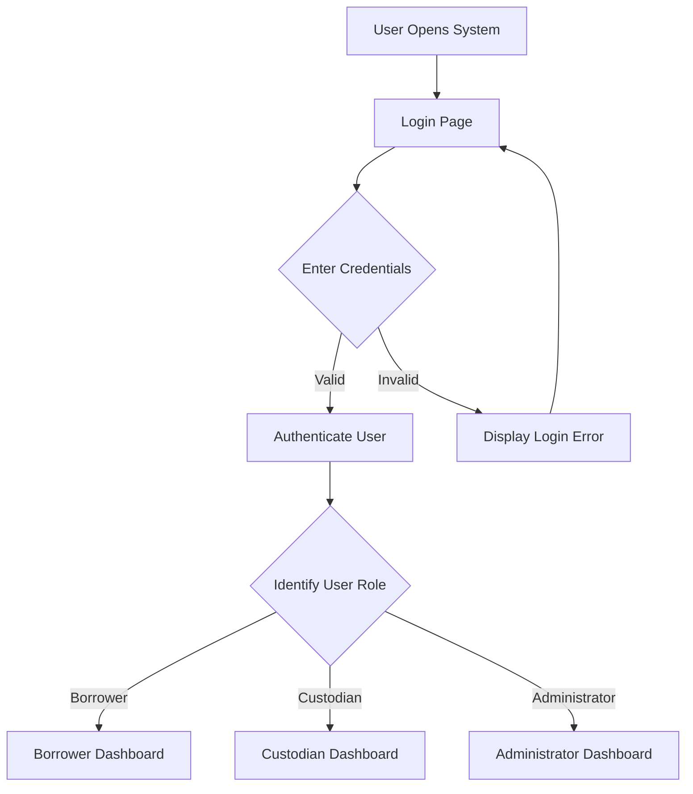

### Password Reset

The system uses **ASP.NET Core Identity** for password recovery and Brevo for OTP delivery.

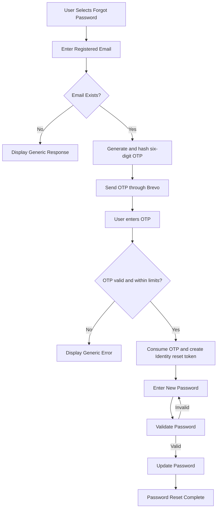

> **Database Note:** No custom `PASSWORD_RESET`, `OTP_CODE`, or `PASSWORD_RESET_TOKEN` table is required. The reset process is handled by ASP.NET Core Identity.

---

## 2. Borrower Workflow

The borrower workflow covers searching equipment, submitting reservations, monitoring reservation status, cancelling reservations, receiving equipment, and returning equipment.

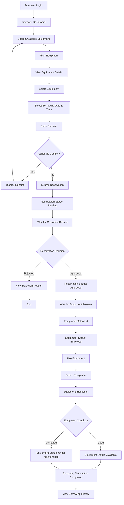

---

## 3. Equipment Search & Availability Workflow

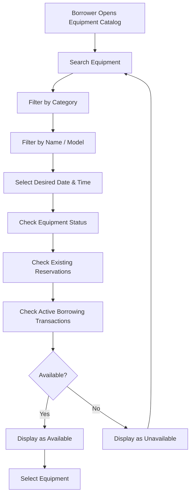

The availability check should consider both the equipment's current status and conflicting reservation schedules.

> **Version 1 data rule:** Each reservation references exactly one physical equipment item. A borrower who needs several items submits one reservation per item.

---

## 4. Reservation Workflow

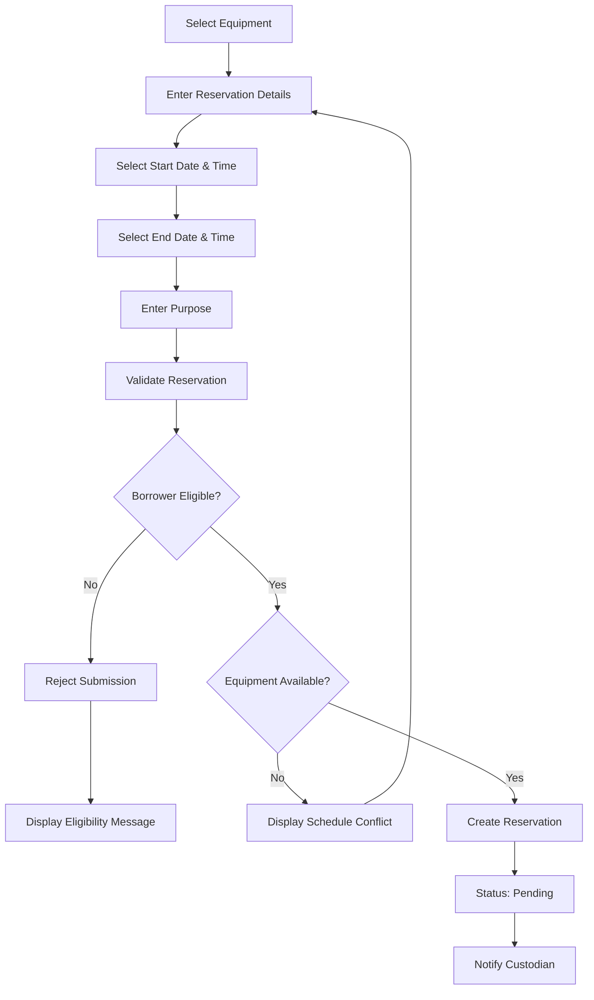

---

## 5. Reservation Approval Workflow

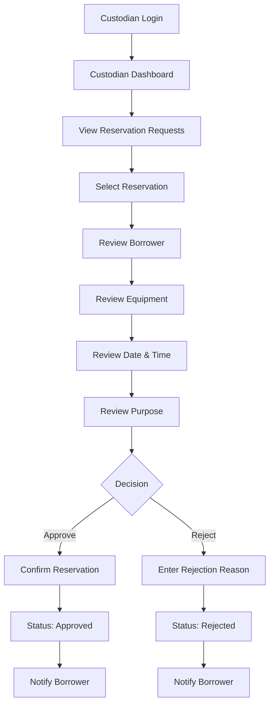

The requirements specify that rejection should include a mandatory explanation visible to the applicant.

---

## 6. Equipment Release Workflow

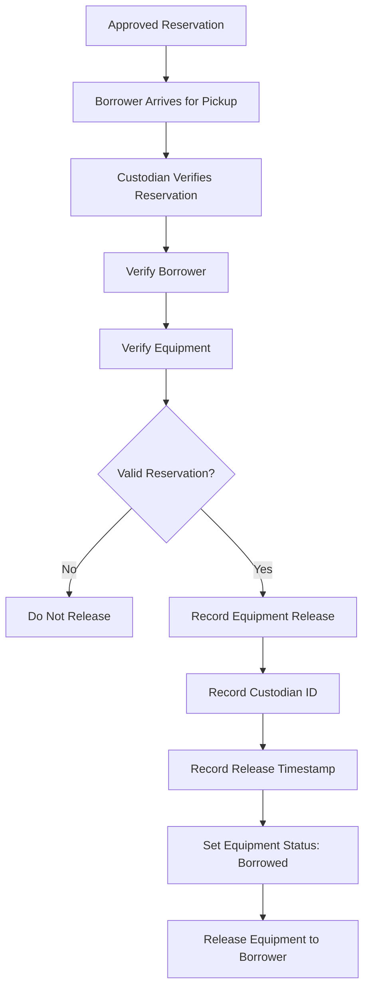

The release transaction records the custodian, actual release timestamp, and changes the equipment status to **Borrowed**.

---

## 7. Equipment Return Workflow

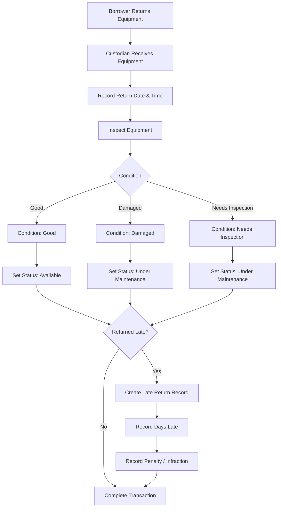

The system identifies late returns and records associated penalties or infractions against the borrower's record.

---

## 8. Equipment Status Lifecycle

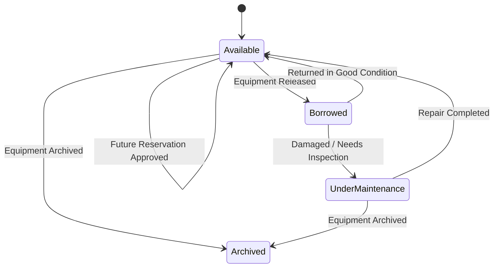

### Main Statuses

| Status | Description |
|---|---|
| **Available** | Equipment can be reserved or released. |
| **Borrowed** | Equipment has been released to a borrower. |
| **Under Maintenance** | Equipment is damaged or requires inspection/repair. |
| **Archived** | Equipment is no longer available for new transactions. |

An approved reservation blocks its scheduled time range but does not permanently change the item's current physical status to `Reserved`. The availability service combines the operational status with approved reservation ranges and active releases.

---

## 9. Late Return Workflow

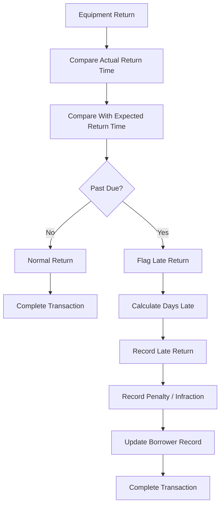

---

## 10. Borrowing History Workflow

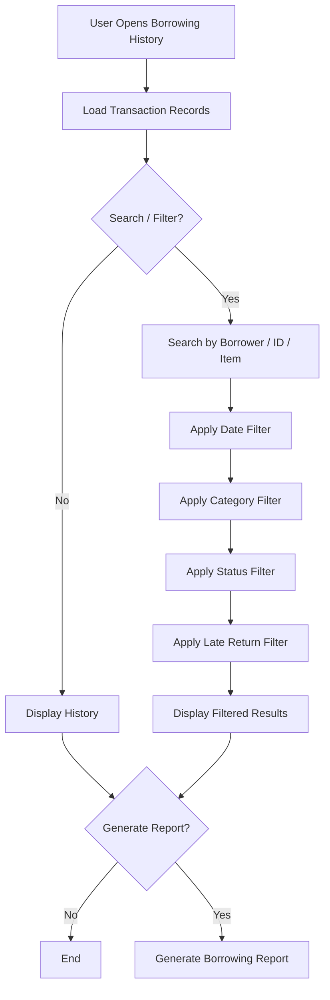

The borrowing history includes reservation, release, return, cancelled, and overdue records. Search covers borrower name, user code, school ID, item name, and item code. Filters include borrower, item/category, scheduled borrowing-start date range, status, and late-return status. Results are paginated and displayed in Philippine time. Authorized users can download a CSV containing all matching filtered records; the download uses the same access scope and filters as the page.

---

## 11. Availability Calendar Workflow

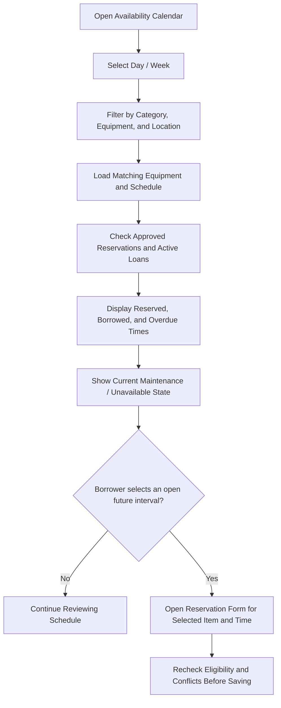

The calendar is read-only; the reservation service remains responsible for final eligibility and conflict checks. Equipment location is filtered as free text stored on each item. The calendar does not show borrower identity or request purpose. Maintenance and unavailable items have no recorded schedule end date, so the calendar shows their current state without implying a repair completion time.

---

## 12. Administrator Workflow

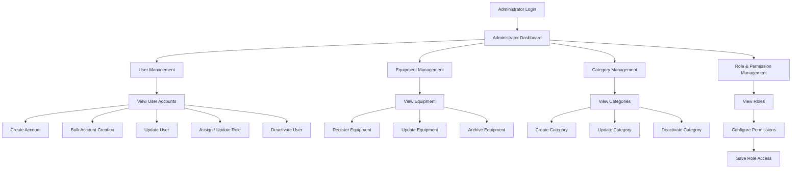

The administrator functions include account creation, bulk CSV account creation, role assignment, permission configuration, user deactivation, and equipment/category management.

Bulk account creation is available from **Users & Roles → Import CSV** under WBS 15.00. An authorized active administrator uploads a UTF-8 CSV containing at most 100 accounts (1 MiB). All rows must pass validation; the complete batch, including role assignments, borrower profiles, and audit records, commits in one transaction or rolls back together. New borrower profiles start ineligible. Uploads contain initial passwords and are processed in memory without retaining the original file or including passwords in errors/audit records. See [CSV import instructions](USER_CSV_IMPORT.md) for the template and operational details.

---

## 13. Complete System Workflow

The following represents the **high-level workflow of the entire system**:

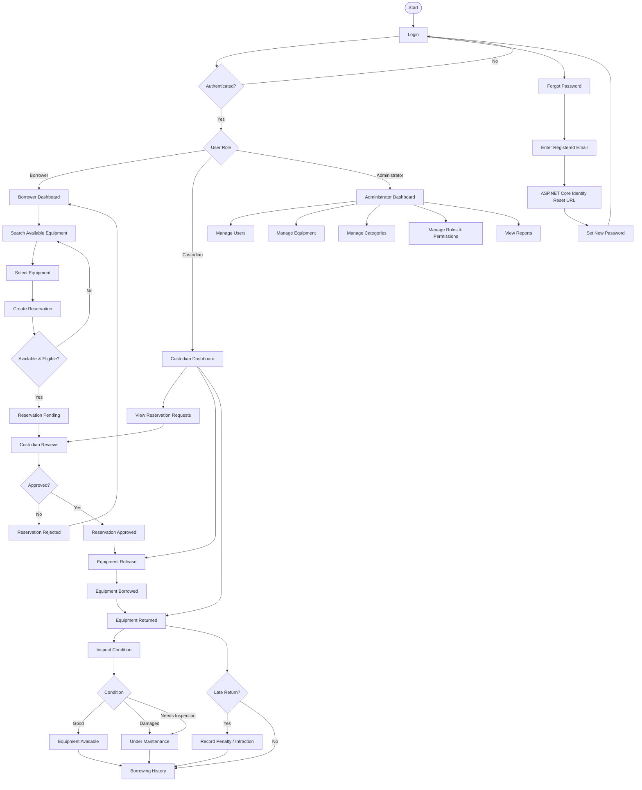

---

## 14. Core Business Process

The most important business process can be summarized as:

```text
Borrower
   │
   ▼
Search Equipment
   │
   ▼
Create Reservation
   │
   ▼
Reservation Pending
   │
   ▼
Custodian Review
   │
   ├─────────────── Reject ──────► End
   │
   ▼
Approve Reservation
   │
   ▼
Equipment Release
   │
   ▼
Equipment Borrowed
   │
   ▼
Equipment Return
   │
   ▼
Condition Inspection
   │
   ├── Good ─────────────► Available
   │
   └── Damaged ──────────► Under Maintenance
   │
   ▼
Check Late Return
   │
   ├── Not Late ─────────► Complete
   │
   └── Late ─────────────► Record Penalty
                              │
                              ▼
                           Complete
```

## 15. Actors

| Actor | Main Responsibilities |
|---|---|
| **Borrower** | Search equipment, submit reservations, view reservation status, cancel reservations, borrow and return equipment, view borrowing history. |
| **Custodian** | Review reservations, approve/reject requests, release equipment, receive returns, inspect equipment, and record late returns. |
| **Administrator** | Manage users, roles, permissions, equipment, categories, and system administration. |

## 16. Authentication Architecture

```text
                    ┌──────────────────────┐
                    │  APPLICATION USER    │
                    └──────────┬───────────┘
                               │
                               ▼
                    ┌──────────────────────┐
                    │ ASP.NET Core Identity│
                    └──────────┬───────────┘
                               │
                ┌──────────────┴──────────────┐
                │                             │
                ▼                             ▼
          Login / Roles               Password Reset
                │                             │
                │                    Cryptographic Token
                │                             │
                │                             ▼
                │                       Reset URL
                │                             │
                ▼                             ▼
        Application Access              New Password
```

**Important:** The password-reset OTP/token mechanism is an authentication implementation detail and does **not** introduce a custom entity into the business ERD.

ASP.NET Core Identity stores the account in `AspNetUsers` through the `ApplicationUser` model. School-specific borrowing fields and eligibility are stored separately in `BORROWER_PROFILE`.


## Workspace refinement — 11/6/2026

New reservation requests use full Philippine calendar days. Start must be tomorrow or later; End may equal Start and includes the whole selected day. Store Start at Manila midnight and End at midnight after the inclusive End date, converted to UTC, with IsFullDay=true. Conflict checks retain half-open intervals [start, end). Existing timed reservations remain unchanged (IsFullDay=false). Releases and actual returns retain timestamps. Scheduled-date labels show the inclusive End for full-day records; overdue and late-return calculations continue using the stored deadline.

My borrowing history supports reservation-code, item-code and item-name search within the signed-in borrower's records, combined with status tabs and 10-row pagination. Custodian Quick Access links open Equipment and Reports under existing permissions.

The calendar uses equipment rows with Week/Day navigation, equipment search and an optional category filter. Location, equipment and view dropdowns are removed. Available future days link to date-only requests for authorized borrowers; submission still rechecks eligibility and conflicts. Existing events stay private; borrower identity is not exposed. Maintenance is current state with no promised completion date.

Equipment and Categories use separate tabs. Delete soft-deletes equipment through the existing archive flag, preserves history and existing transaction restrictions, and retains Restore. New item codes are server-assigned as CATEGORY-001-ASU: a persistent per-category counter, at least three digits, plus the first three letters of the item name uppercased and padded with X if needed. Allocation and insertion share a serializable transaction and category-row lock; the first allocation advances past existing matching codes including archived items. Existing item codes stay unchanged on edits.

Login has no appearance control. Authenticated pages offer a Light/Dark icon toggle; legacy System preferences default to Light. Reports retain both date filters and CSV export, remove the separate item filter and Excel download control. Existing Excel endpoint remains available for compatibility.
