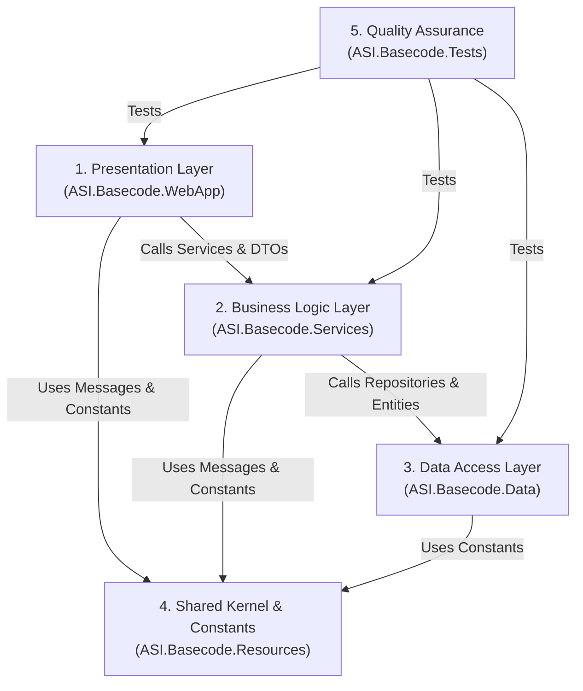

# Gearantee System Architecture Specification

## 1. Architectural Overview & Vision

**Gearantee** is an enterprise campus equipment borrowing and reservation system built on **ASP.NET Core MVC** (.NET 9) with **Entity Framework Core 9**, **ASP.NET Core Identity**, and **SQL Server**.

This document defines the **canonical system architecture** for the Gearantee solution. It establishes strict layer boundaries, rules of engagement, and the designated purpose and placement of all components across the codebase.

---

## 2. Core Architectural Principles & Dependency Rules

The solution follows a strict **N-Tier Layered Architecture** with a **Shared Kernel (Resources)**:



### 2.1 The Golden Rules of Dependency Flow

1. **Strict Downward Dependency**:
   - `WebApp` depends on `Services` and `Resources`.
   - `Services` depends on `Data` and `Resources`.
   - `Data` depends only on `Resources` (and EF Core infrastructure packages).
   - `Resources` has **zero** project dependencies.
   - No circular references are permitted under any circumstance.
2. **No Web/HTTP Leaks in Lower Layers**:
   - `Services` and `Data` must never reference `Microsoft.AspNetCore.Http`, `ISession`, cookies, `HttpContext`, or UI presentation namespaces.
3. **No Direct EF Core / Database Leaks in Controllers**:
   - Controllers must never inject `DbContext`, start raw database transactions, execute LINQ database queries, or mutate entities directly. All persistence is delegated to `Services`.
4. **No Presentation Concerns in Services**:
   - ViewModels decorated with UI labels (`[Display(Name = ...)]`) and client-side validation rules belong strictly in `WebApp`. `Services` operates solely on clean Data Transfer Objects (DTOs) and business models.
5. **Shared Domain Constants Reside in Resources**:
   - Domain roles, permissions, reservation statuses, and equipment states must live in `Resources` so that `WebApp`, `Services`, and `Data` can reference them without cross-layer coupling.

---

## 3. Layer-by-Layer Purpose & Boundaries

### Layer 1: `ASI.Basecode.WebApp` (Presentation Layer)

#### Purpose
Acts as the application entry point and composition root. Responsible for receiving HTTP requests, managing authentication sessions, validating model state, rendering Razor views, and returning HTTP/JSON responses.

#### Designated Responsibilities
- **Controllers (`Controllers/`)**: Handle incoming HTTP requests, enforce controller-level authorization attributes (`[Authorize]`), map request data to service contracts, invoke services, and choose views or redirects. All controllers must inherit from `ControllerBase<T>`.
- **ViewModels (`Models/`)**: Contain presentation data contracts tailored for UI forms and views, decorated with `[Display]`, form validation attributes, and dropdown selections.
- **Base Controllers & MVC Infrastructure (`Mvc/`)**: Reusable controller logic (`ControllerBase<T>`), action filters, custom model binders, and view components.
- **Authentication & Authorization (`Authorization/`)**: Cookie authentication configuration, custom claims principal factories, and policy requirement handlers.
- **Host Configuration (`Configuration/`)**: Application startup binders, Serilog logger setup, and filesystem path managers (`PathManager`).
- **Views & Static Assets (`Views/`, `wwwroot/`)**: Razor `.cshtml` markup, partials, client-side scripts, styles, and static assets.

#### Strict Boundaries (What is Prohibited)
- ❌ No direct `DbContext` injection or manual database transactions.
- ❌ No business logic calculations (e.g., late penalties, date span eligibility).
- ❌ No database migrations or canonical database seeding code.

---

### Layer 2: `ASI.Basecode.Services` (Business Logic Layer)

#### Purpose
The domain core of the application. Responsible for enforcing all business rules, managing workflow state transitions, orchestrating repository calls, sending transactional communications, and validating business invariants.

#### Designated Responsibilities
- **Service Interfaces (`Interfaces/`)**: Pure contracts defining all business operations (`IReservationService`, `IReturnRecordService`, `ICatalogService`, `IBorrowerProfileService`, `IAccountService`, `IUserAdministrationService`, `IAuditService`, etc.).
- **Service Implementations (`Services/`)**: Execute business logic, enforce eligibility rules, coordinate domain transactions through `IUnitOfWork`, and emit audit events.
- **Service Models & DTOs (`ServiceModels/`)**: Plain data structures used for passing data into and out of services (Commands, Queries, DTOs). Free of UI formatting attributes.
- **Standardized Results (`Common/` or `ServiceModels/Common/`)**: Unified operation outcome wrappers (`ServiceResult<T>`) conveying status, errors, and domain states.
- **Domain Utilities (`Utilities/`)**: Pure algorithmic helpers such as Philippine Standard Time handling (`ManilaClock`) and CSV parsers.
- **External Client Integrations (`Integrations/`, `Configuration/`)**: Third-party API clients (e.g., Brevo email sending) and their options classes (`BrevoOptions`).

#### Strict Boundaries (What is Prohibited)
- ❌ No HTTP/Web dependencies (`ISession`, cookies, `IFormFile`).
- ❌ No casting `unitOfWork.Database` to concrete `AsiBasecodeDBContext`.
- ❌ No raw SQL table lock hints (`UPDLOCK`, `ROWLOCK`) or application locks (`sys.sp_getapplock`).
- ❌ No UI display strings, localization attributes, or screen formatting models.

---

### Layer 3: `ASI.Basecode.Data` (Data Access & Persistence Layer)

#### Purpose
Responsible solely for database communication, entity-relationship mapping via EF Core, database migrations, database-level locking, and canonical database seeding.

#### Database Tables & Entity Mapping (17 Total Tables)
The SQL Server database contains **17 physical tables**, split into two categories:
1. **6 ASP.NET Core Identity Tables** (inherited from `IdentityDbContext`):
   - `AspNetUsers` (mapped to custom `ApplicationUser.cs`)
   - `AspNetRoles` (mapped to `IdentityRole`)
   - `AspNetUserRoles` (join table for user-role assignments)
   - `AspNetUserClaims`, `AspNetRoleClaims` (identity claims)
   - `AspNetUserTokens` (stores password reset OTP hashes)
   - **Removed:** `AspNetUserLogins` is no longer mapped (`IdentityUserLogin` is ignored) and was dropped by the `NormalizeUserAndBorrowerSchema` migration because external login providers are not used.
2. **11 Custom Domain Entity Tables** (explicit `DbSet<T>` in `AsiBasecodeDbContext`):
   - `EquipmentCategory` (`EquipmentCategory.cs`)
   - `EquipmentItem` (`EquipmentItem.cs`)
   - `BorrowerProfile` (`BorrowerProfile.cs`)
   - `Reservation` (`Reservation.cs`)
   - `ReleaseRecord` (`ReleaseRecord.cs`)
   - `ReturnRecord` (`ReturnRecord.cs`)
   - `LateReturn` (`LateReturn.cs`)
   - `Permission` (`Permission.cs`)
   - `RolePermission` (`RolePermission.cs`)
   - `RolePermissionSeed` (`RolePermissionSeed.cs`)
   - `AdministrationAuditEvent` (`AdministrationAuditEvent.cs`)

#### Designated Responsibilities
- **Database Context (`AsiBasecodeDbContext.cs`)**: Defines all `DbSet<T>` tables and coordinates model creation.
- **Entities (`Entities/` or `Models/`)**: Plain Old CLR Objects (POCOs) mapped 1:1 to database tables (`Reservation`, `EquipmentItem`, `BorrowerProfile`, `ApplicationUser`, etc.).
- **Entity Configurations (`Configurations/`)**: Fluent API mappings split into one dedicated configuration class per entity.
- **Repositories & Unit of Work (`Interfaces/`, `Repositories/`)**:
  - Repositories encapsulate database queries and staging mutations (`Add`, `Update`, `Remove`).
  - `IUnitOfWork` coordinates atomic commits via `SaveChangesAsync()`. Repositories do not unilaterally call `SaveChanges()`.
- **Database Concurrency & Locking (`Locks/`)**: Provider-specific SQL Server locking mechanisms (query hints such as `UPDLOCK, ROWLOCK` and application locks via `sys.sp_getapplock`).
- **Database Seeding (`Seeding/`)**: Initial canonical schema seeding (roles, default permissions, administrator accounts).
- **EF Core Migrations (`Migrations/`)**: Version-controlled database schema migrations.

#### Strict Boundaries (What is Prohibited)
- ❌ No business rule validation or workflow decisions.
- ❌ No logging filesystem directory helpers (such as Serilog `PathManager`).
- ❌ No presentation or HTTP references.

---

### Layer 4: `ASI.Basecode.Resources` (Shared Kernel / Constants Layer)

#### Purpose
A lightweight, dependency-free Shared Kernel containing all centralized constants, enums, error messages, and localized string resources.

#### Designated Responsibilities
- **Domain Constants (`Constants/`)**: System roles, permissions, reservation statuses, equipment statuses, and return conditions (`DomainValues.cs`).
- **Domain Enums (`Enums/`)**: Shared domain-wide enumerations.
- **Resource Files (`Messages/`, `Views/`)**: Localized `.resx` string tables (`Errors.resx`, `Common.resx`, UI labels) and auto-generated designer classes.

#### Strict Boundaries (What is Prohibited)
- ❌ Zero dependencies on any other project in the solution.
- ❌ No executable business logic or database access.

---

### Layer 5: `ASI.Basecode.Tests` (Quality Assurance & Test Suite)

#### Purpose
Verifies system behavior, business rules, concurrency guarantees, and authorization boundaries through automated execution.

#### Designated Responsibilities
- **Feature Test Suites**: Test files organized into folders mirroring functional modules (`Reservations/`, `Returns/`, `BorrowerProfiles/`, `Category/`, `Dashboard/`, `UserAdministration/`, `Auth/`).
- **Shared Test Infrastructure (`Fixtures/` or `Common/`)**: Reusable test database factories (SQLite in-memory, LocalDB harnesses), test clocks, and authenticated test environments.

---

## 4. Target Directory & File Structure

```
c:\Users\PJ Pineda\Desktop\Alliance\Gearantee\
│
├── ASI.Basecode.Resources/                       # [SHARED KERNEL]
│   ├── Constants/
│   │   ├── DomainValues.cs                       # Roles, Permissions, Statuses, Conditions
│   │   └── AppConstants.cs
│   ├── Enums/
│   │   └── DomainEnums.cs
│   └── Messages/                                 # Localized .resx resources
│       ├── Common.resx
│       ├── Errors.resx
│       └── Views/
│
├── ASI.Basecode.Data/                            # [DATA ACCESS LAYER]
│   ├── AsiBasecodeDbContext.cs                   # EF Core DbContext
│   ├── UnitOfWork.cs                             # Coordinates atomic SaveChangesAsync
│   ├── Configurations/                           # One Fluent API configuration per entity
│   │   ├── ApplicationUserConfiguration.cs
│   │   ├── EquipmentItemConfiguration.cs
│   │   ├── EquipmentCategoryConfiguration.cs
│   │   ├── ReservationConfiguration.cs
│   │   ├── BorrowerProfileConfiguration.cs
│   │   ├── ReleaseRecordConfiguration.cs
│   │   ├── ReturnRecordConfiguration.cs
│   │   ├── LateReturnConfiguration.cs
│   │   ├── PermissionConfiguration.cs
│   │   ├── RolePermissionConfiguration.cs
│   │   ├── RolePermissionSeedConfiguration.cs
│   │   └── AdministrationAuditEventConfiguration.cs
│   ├── Entities/ (or Models/)                    # Pure EF Core Table Entities (Custom domain models)
│   │   ├── ApplicationUser.cs                    # Extends IdentityUser (AspNetUsers)
│   │   ├── EquipmentCategory.cs                  # EquipmentCategory table
│   │   ├── EquipmentItem.cs                      # EquipmentItem table
│   │   ├── BorrowerProfile.cs                    # BorrowerProfile table
│   │   ├── Reservation.cs                        # Reservation table
│   │   ├── ReleaseRecord.cs                      # ReleaseRecord table
│   │   ├── ReturnRecord.cs                       # ReturnRecord table
│   │   ├── LateReturn.cs                         # LateReturn table
│   │   ├── Permission.cs                         # Permission table
│   │   ├── RolePermission.cs                     # RolePermission table
│   │   ├── RolePermissionSeed.cs                 # RolePermissionSeed table
│   │   └── AdministrationAuditEvent.cs           # AdministrationAuditEvent table
│   ├── Interfaces/                               # Repository and Unit of Work interfaces
│   │   ├── IUnitOfWork.cs
│   │   ├── IEquipmentItemRepository.cs
│   │   ├── IReservationRepository.cs
│   │   ├── IBorrowerProfileRepository.cs
│   │   ├── IReturnRecordRepository.cs
│   │   ├── ICategoryRepository.cs
│   │   └── IAuditEventRepository.cs
│   ├── Repositories/                             # Implementations staging DB operations
│   │   ├── BaseRepository.cs                     # Namespace: ASI.Basecode.Data.Repositories
│   │   ├── EquipmentItemRepository.cs            # Includes UPDLOCK/ROWLOCK concurrency queries
│   │   ├── ReservationRepository.cs
│   │   ├── BorrowerProfileRepository.cs
│   │   ├── ReturnRecordRepository.cs
│   │   ├── CategoryRepository.cs
│   │   └── AuditEventRepository.cs
│   ├── Locks/
│   │   └── ApplicationLockManager.cs             # Centralized sys.sp_getapplock queries
│   ├── Seeding/
│   │   └── DatabaseSeeder.cs                     # Canonical DB migrations & data seeding
│   └── Stores/
│       └── IdentityPasswordResetOtpStore.cs      # EF Core backed OTP token persistence
│
├── ASI.Basecode.Services/                        # [BUSINESS LOGIC LAYER]
│   ├── Common/
│   │   └── ServiceResult.cs                      # Unified OperationResult / ServiceResult<T>
│   ├── Configuration/
│   │   └── BrevoOptions.cs                       # Email settings POCO
│   ├── Interfaces/                               # Business service contracts
│   │   ├── IAccountService.cs                    # Public registration, password resets
│   │   ├── IReservationService.cs
│   │   ├── IReturnRecordService.cs
│   │   ├── ICatalogService.cs
│   │   ├── ICategoryService.cs
│   │   ├── IEquipmentItemService.cs
│   │   ├── IBorrowerProfileService.cs
│   │   ├── IUserAdministrationService.cs
│   │   ├── IAvailabilityCalendarService.cs
│   │   ├── IBorrowingHistoryService.cs
│   │   ├── IPasswordResetOtpService.cs
│   │   ├── IAuditService.cs
│   │   └── IBrevoEmailSender.cs
│   ├── ServiceModels/                            # Clean Data Transfer Objects (no UI attributes)
│   │   ├── Account/
│   │   ├── Reservations/
│   │   ├── Catalog/
│   │   ├── Returns/
│   │   ├── Inventory/
│   │   └── UserAdministration/
│   ├── Services/                                 # Business Logic Implementations
│   │   ├── AccountService.cs
│   │   ├── ReservationService.cs
│   │   ├── ReturnRecordService.cs
│   │   ├── CatalogService.cs
│   │   ├── CategoryService.cs
│   │   ├── EquipmentItemService.cs
│   │   ├── BorrowerProfileService.cs
│   │   ├── UserAdministrationService.cs
│   │   ├── AvailabilityCalendarService.cs
│   │   ├── BorrowingHistoryService.cs
│   │   ├── PasswordResetOtpService.cs
│   │   ├── AuditService.cs
│   │   └── BrevoEmailSender.cs
│   └── Utilities/                                # Stateless calculations and helpers
│       ├── ManilaClock.cs                        # Philippine Standard Time converter
│       ├── ReservationAvailability.cs
│       ├── ReturnInspection.cs
│       ├── UserImportCsv.cs
│       └── BorrowingHistoryCsvFormatter.cs
│
├── ASI.Basecode.WebApp/                          # [PRESENTATION LAYER]
│   ├── Program.cs                                # Host bootstrap & CLI argument handler
│   ├── Startup.cs                                # HTTP middleware pipeline
│   ├── Startup.Auth.cs                           # Authentication & Cookie setup
│   ├── Startup.DI.cs                             # IoC container registrations
│   ├── Startup.Logger.cs                         # Serilog configuration
│   ├── Authorization/                            # Claims & Policy wiring
│   │   └── ApplicationClaimsPrincipalFactory.cs
│   ├── Configuration/
│   │   ├── ConfigurationExtensions.cs
│   │   └── PathManager.cs                        # Filesystem & Serilog logging paths
│   ├── Controllers/                              # All inherit ControllerBase<T>
│   │   ├── AccountController.cs                  # Uses IAccountService
│   │   ├── AvailabilityCalendarController.cs
│   │   ├── BorrowerProfileController.cs
│   │   ├── BorrowingHistoryController.cs
│   │   ├── CatalogController.cs
│   │   ├── CategoriesController.cs               # Inherits ControllerBase<T>
│   │   ├── DashboardController.cs
│   │   ├── HomeController.cs
│   │   ├── ReservationController.cs
│   │   ├── ReservationReviewController.cs
│   │   ├── ReturnRecordController.cs
│   │   └── UsersController.cs                    # Inherits ControllerBase<T>
│   ├── Models/                                   # UI ViewModels with [Display], [Required]
│   │   ├── Account/ (Login, Register, ResetPassword)
│   │   ├── Dashboard/ (KpiTile, EmptyState)
│   │   ├── Reservations/ (Forms, Details, Lists)
│   │   ├── Catalog/
│   │   ├── Returns/
│   │   └── UserAdministration/
│   ├── Mvc/
│   │   └── ControllerBase.cs                     # Shared base controller with ViewData, logging
│   ├── Views/                                    # Razor view hierarchy
│   │   ├── _ViewImports.cshtml                   # Imports Resources.Constants
│   │   ├── Shared/
│   │   │   ├── _Layout.cshtml
│   │   │   ├── _Sidebar.cshtml
│   │   │   └── _Topbar.cshtml
│   │   └── [FeatureFolders]/
│   └── wwwroot/                                  # Static assets (css, js, images)
│
└── ASI.Basecode.Tests/                           # [QUALITY ASSURANCE]
    ├── Fixtures/                                 # Shared test databases & mocks
    ├── Auth/                                     # Tests for login, OTP, registration
    ├── Reservations/
    ├── Returns/
    ├── Category/
    ├── BorrowerProfiles/
    ├── Dashboard/
    └── UserAdministration/
```
